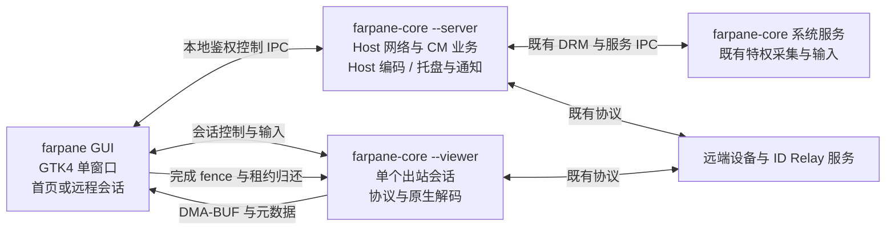
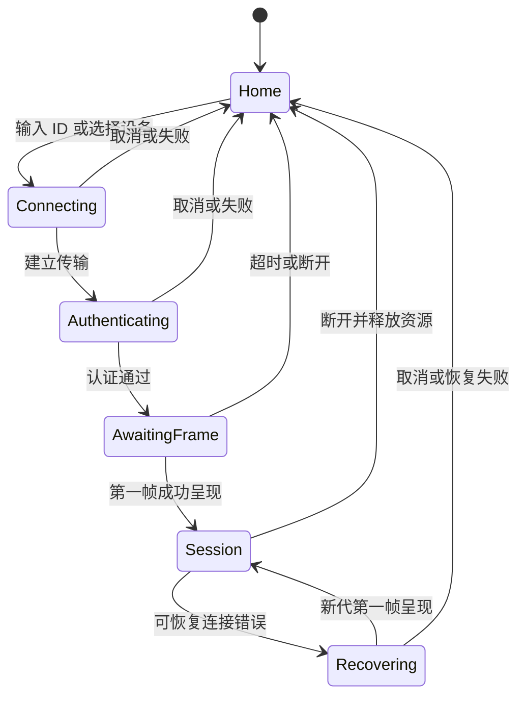

# FarPane Linux GPU 媒体重构（linux-host）：原生 GUI 重构方案

2026-10-18 实现补充：§5.2 的工具条收起/展开已接通，失败时恢复控件，真实软件连接验证画面空间、键释放与坐标；[`.6` 候选与边界](viewer-toolbar.md)。内存优先级仍按用户接受现状的决定执行。

用户优先级修订（2026-10-18）：当前内存已可接受，进一步优化先停。下文首页 60 MiB 保留为参考目标，未达到它不再单独阻塞交付；由它推导的组合预算也不能据此要求继续压缩首页。保留真实资源测量、泄漏/持续增长检查及功能和稳定性验收，不将本次取舍记作数值达标。[字体实验已收尾](home-font-fallback.md)，实验性字体不进入产品。后续以功能缺陷和交付验收为优先。

日期：2026-10-16（Asia/Shanghai）。版本：v2.1，Claude 已完成 v2 只读复核并确认可实施；现按用户授权进入开发，实际可行性仍以 U0 原型为门槛，尚未替换运行中的应用。评审原文与采纳记录见 [评审记录](../../Evidence/LinuxHost/2026-10-16-gui-review/README.md)。

按用户决定重写 Linux GUI，对标本仓库 Mac 版的首页和远程会话体验。采用 **Rust + GTK4 + libadwaita**，复用现有 Rust 网络与 Host GPU 媒体核心；目标是一个 GUI 进程、一个主窗口、两种主要视图，并消除独立常驻的 Flutter 主窗口、Flutter 连接管理窗口和托盘进程。出站 Viewer 使用按会话启动的独立 core worker，避免 Host 监管和桌面会话切换连带结束出站连接；按全部进程总资源验收，不追求固定进程数量。

首个交付范围是完整 Linux Host + 单会话 Viewer。远程画面显示、输入、音频、剪贴板和文件传输均属于方案范围，不能只完成首页后称为重构完成。Linux GPU Host 当前支持范围继续以 [P1 状态](p1-status.md) 为准；GUI 跨发行版运行不等于所有 GPU、显示器和会话类型都已通过媒体验收。

当前实作进度与逐项验证见 [gui-status.md](gui-status.md)；Viewer 富剪贴板、Host 分类策略/共享控件、X11 有界读写和 GUI 分块输出已接通，两轮实际连接验证了最大字节 PNG 双向传输。Host Wayland data-control 已接通并通过私有 Sway/Weston 的协议与能力缺失测试；真实 Wayland 桌面/网络链路、最大像素 RGBA、跨平台与整体峰值内存仍待验收，不能据此认为 U4 或安装包已完成。

## 1. Mac 版实际对标范围

Mac 版确实复用同一个 `NSWindow`：`showHomeUI()` 设置首页，`launchViewer()` 换成会话视图。返回首页会停止 Viewer 音频、剪贴板、文件传输及定时器，释放解码器和渲染器。**两种主要视图不代表只有两个功能页面**：首页还有“设备”“授权与安全”“共享设置”三个分区，并使用按需打开的设置和密码对话框。

只读对标依据为本地基线 `b01c40bd7da588f0ec2add2947a9368289006792` 的 Mac 源码，本方案不修改 Mac 实现。

| 能力 | Mac 版依据 | Linux 重构要求 |
| --- | --- | --- |
| 首页与会话切换 | [AppDelegate+Home.swift](../../Sources/RustDeskNative/AppDelegate+Home.swift)、[AppDelegate+Viewer.swift](../../Sources/RustDeskNative/AppDelegate+Viewer.swift) | 复用一个窗口；切换时释放离开视图的资源，不隐藏保留两棵完整界面树 |
| 设备管理 | [HomeView+Devices.swift](../../Sources/RustDeskNative/HomeView+Devices.swift) | 快速连接、最近连接、收藏、别名、搜索、忘记设备；列表虚拟化 |
| 自建服务器与密码 | [ConnectionDialogs.swift](../../Sources/RustDeskNative/ConnectionDialogs.swift) | ID/Relay、公钥、强制中继；密码错误可重试；可选安全保存远端密码 |
| 被控 Host | [HomeView+ConnectionControls.swift](../../Sources/RustDeskNative/HomeView+ConnectionControls.swift) | 允许被控、本机 ID、当前认证方式、临时密码状态、永久密码设置及清除 |
| 入站审批与撤权 | [HomeView+SessionBanners.swift](../../Sources/RustDeskNative/HomeView+SessionBanners.swift) | 显示请求者与能力；允许、拒绝、超时；连接中撤销权限和断开 |
| 共享能力 | [HomeView+SharingSettings.swift](../../Sources/RustDeskNative/HomeView+SharingSettings.swift) | 音频、剪贴板类型与方向、文件接收根目录及逐次确认；能力不支持时明确说明 |
| 远程会话 | [ViewerUI.swift](../../Sources/RustDeskNative/ViewerUI.swift) | 画面、状态、键鼠与输入法、独占键盘、多显示器选择、发送/接收文件、音频状态、全屏、断开 |
| HUD | [ViewerHUDPanel.swift](../../Sources/RustDeskNative/ViewerHUDPanel.swift) | 按需显示 FPS、延迟、丢帧、CPU、内存和媒体后端；本地工具条/HUD 操作不发送为远端输入 |
| 睡眠与网络恢复 | [HostAgentSleepWakeRecoveryProcessOwner.swift](../../Sources/RustDeskNative/HostAgentSleepWakeRecoveryProcessOwner.swift)、[HostAgentNetworkPathRecoveryProcessOwner.swift](../../Sources/RustDeskNative/HostAgentNetworkPathRecoveryProcessOwner.swift) | 监听 logind 睡眠与网络状态，有限恢复注册和连接；旧事件不覆盖新代 |
| 音频输入选择 | [HostAudioInputDeviceCatalog.swift](../../Sources/RustDeskNative/HostAudioInputDeviceCatalog.swift) | 枚举 PulseAudio/PipeWire source，区分系统音频与麦克风；设备失效提示及权限按用户选择执行 |
| 后台注册 | [AppDelegate+HostRegistration.swift](../../Sources/RustDeskNative/AppDelegate+HostRegistration.swift) | 显式开启后台运行；迁移本产品自启动入口，后台与 GUI 生命周期分离 |
| 窗口与滚轮 | [ViewerWindowSizer.swift](../../Sources/RustDeskNative/ViewerWindowSizer.swift)、[ViewerInput](../../Sources/ViewerInput) | 远端尺寸适配本地可见区域；离散/高精度滚轮映射、缩放与方向一致 |
| 会话日志 | [ViewerSessionLiveLog.swift](../../Sources/RustDeskNative/ViewerSessionLiveLog.swift)、[AppDelegate+HostTelemetry.swift](../../Sources/RustDeskNative/AppDelegate+HostTelemetry.swift) | 有界实时日志与可导出的脱敏诊断；日志失败不终止会话 |
| 品牌 | [HomeBrand.swift](../../Sources/RustDeskNative/HomeBrand.swift)、[HomeModels.swift](../../Sources/RustDeskNative/HomeModels.swift)、[App/Brand](../../App/Brand) | 沿用 FarPane 双窗标志、深色背景、青绿色操作强调；适配 Linux 的系统控件与无障碍 |

Linux 的权限页显示本机实际会话、采集/输入权限与可用后端，不照搬 macOS 的 TCC 设置项。Wayland 独占键盘、剪贴板及后台授权需要逐桌面验证；能力不足时禁用对应入口并解释原因。独占键盘通过 GDK shortcut inhibit 请求，并观察实际授权/撤销结果，不能把请求发出视为成功；相对鼠标/指针锁定首版不支持，不冒充普通绝对坐标模式。[GDK 官方接口](https://docs.gtk.org/gdk4/method.Toplevel.inhibit_system_shortcuts.html)。

首版仅允许一个出站 Viewer；收到第二次连接请求时提示替换或取消，明确结束旧会话后再创建新会话。目标同时支持一个入站 Host 会话与一个出站 Viewer，会话和权限状态互相独立，组合场景单列验收。聊天、远程终端、白板、端口转发、账户/通讯录云服务不加入这次 GUI，后端已有能力不因此自动删除。

## 2. 内存基线与目标

2026-10-16 15:22:29 的 5 秒只读采样中，一条入站连接全程保持 `backend=gpu`、generation=3，五个 PID 稳定。安装版本为 `farpane-p1-445515cfa1ec-90876510-551585f0`。原始记录见 [runtime-sample.json](../../Evidence/LinuxHost/2026-10-16-gui-plan/runtime-sample.json)。

| 角色 | 实测 PSS KiB | 换算 MiB |
| --- | ---: | ---: |
| 系统服务 | 46,605 | 45.5 |
| 用户媒体服务 | 55,804 | 54.5 |
| Flutter 主窗口 | 109,737 | 107.2 |
| Flutter 连接管理窗口 | 99,659 | 97.3 |
| 托盘 | 26,129 | 25.5 |
| 合计 | 337,934 | 330.0 |

两项界面进程合计约 204.5 MiB，占总 PSS 的 62%；其中含共享库、业务状态与图形资源，不能全部视为可删除开销。这是规划基线，不是正式 A/B。PSS 分摊共享驻留页，但不完整覆盖 GPU 内存；另行记录 USS、SwapPss、GPU/共享缓冲与 FD，防止通过换统计口径或增加显存掩盖内存消耗。

以下是**工程验收目标，尚未达到**，均以 linux-host、Release 构建、固定桌面环境为基准：

| 场景 | PSS 预算与要求 |
| --- | --- |
| 无会话，仅首页 | GUI 进程稳态目标不超过 60 MiB；不创建视频解码器和帧池，U0 测量 GTK/驱动实际开销 |
| Host 已开启，GUI 已退出，无连接 | 系统服务 + 用户 agent 合计不超过 120 MiB |
| 单路 2560×1440 H.264 GPU Host，GUI 已退出 | 全部 FarPane 进程合计不超过 150 MiB |
| 相同 Host 会话，首页打开 | 全部 FarPane 进程合计不超过 210 MiB，且相对同条件旧版至少下降 35% |
| 单路 2560×1440 硬解 Viewer，Host 关闭 | Viewer worker + GUI 合计目标不超过 240 MiB；首次原型锁定解码 DPB 和 GPU 分配预算，单独报告 |
| Host 与 Viewer 并存 | 四个角色全部计入；U0/U3 根据帧池实测确定组合预算，不能沿用单 Host 的 210 MiB 门槛 |
| 反复连接与断开 | 20 轮后，空闲 PSS 相对预热基线增加不超过 10 MiB，FD/帧租约回到稳定平台，无逐轮增长 |

210 MiB 的初始预算按 Host 后台 150 MiB + 首页 GUI 60 MiB 分解；相对本次 330 MiB 快照约为 36% 下降，比 35% 目标略严格。正式验收同时检查绝对预算与当时同条件 A/B。驱动库和共享页归属会变化，不能把不同模式的 PSS 简单相加当作测量结果。U0 必须用 GTK4/libadwaita 原型验证预算，若不满足应给出分项成本与修订理由，不能静默放宽目标。

旧版“主窗口关闭”的基线要另测，不能用 330 减去 107 MiB 冒充实测值。SNI、Secret Service、CM 文件任务、Viewer worker 和合成器增量全部计入。采样器需按受管理 release 的 executable/角色枚举进程，不能只用名称 `farpane` 或用户 cgroup（现有 server 可经 sudo 拉起），并补 USS、SwapPss 和按 DRM client 去重的 fdinfo 内存；GPU 与 PSS 的重叠单独说明，不能重复相加。

GUI 静止时目标 CPU 不超过单核 0.5%；无新帧时 GtkGLArea 不持续 queue_render，HUD 隐藏时取消指标订阅。Host 总 CPU、帧率和延迟不因重构回退。未达到目标时优先查明重复状态、队列、图形资源和常驻进程；不能通过隐藏审批、关闭权限校验、减少必需功能或降低画面参数达标。

## 3. 技术选择与核心边界

GUI 使用 Rust、gtk4-rs 和 libadwaita，布局采用 GtkBuilder 资源与少量 Rust 自定义组件，资源编入 GResource。新 GUI 不使用 Flutter、Dart、Sciter、WebView 或 Go 运行时。现有 FFmpeg 9.0.2 静态库、Host GPU 媒体适配器和网络身份修复继续复用。

现有 Linux 核心有 `gtk = "0.18"`（GTK3）依赖，`lib.rs` 的非 Flutter 分支会启用旧 `ui` 模块。因此必须增加明确的 headless 构建分支，抽出 UI 回调与业务逻辑；**不能把去掉 `--features flutter` 当作无界面核心，也不把旧核心动态加载进 GTK4 GUI 进程**。

拟新增 `farpane-headless` 特性，与 Flutter/旧 UI 入口互斥。保持 `farpane-linux`、`linux-gpu-media` 的原能力开关；原有构建仍可生成回退版本。根服务与用户 agent 使用同一个 root-owned 核心可执行文件，继续满足原 DRM IPC 的可执行身份校验。

核心接点先审计 `ui_cm_interface` 的 `InvokeUiCM`、`ui_session_interface`、`ui_interface`、`core_main` 和托盘入口。业务逻辑迁入 headless 适配层，UI 回调变为语义事件；既有 Flutter 专属的 cfg 需要逐处拆分，不能依靠空实现吞掉授权、文件或断线事件。独立的 Linux crate/overlay 与 patch 承担改动，原平台构建继续回归；这包含 Cargo 依赖拆分，不能预设只是几处入口修改。

现有 Cargo 还直接依赖 `tao`、`tray-icon`、`sciter-rs`、`winit`、`softbuffer`。必须改为由旧 UI 特性显式启用的 optional 依赖，并在 headless 下排除 `tray`、`whiteboard`、`gtk_sudo` 和旧 `ui` 入口；保留其他平台原有启用关系。GUI 不依赖 `rustdesk` crate，共享协议放入不引入媒体和 GUI 的小 crate。U0 对 core 的 ELF 及递归依赖闭包检查：不得包含 GTK3/GDK3、AppIndicator、Sciter、Flutter；GUI 不得包含 GTK3。运行 `/proc/maps` 复核实际加载，不只检查直接 DT_NEEDED。

首版 GUI 不内置提权对话框或自动提权。系统服务安装/升级由完整安装器及包管理器处理；未安装服务时给出安装入口，设置页仅执行已授权的服务业务命令。移除 headless 对 `gtk_sudo` 的依赖不等于放宽特权接口。

GUI 最低 API 暂定 GTK 4.14、libadwaita 1.5；U0 在隔离构建环境里锁定兼容 Rust 1.89 的 crate 版本与 Cargo.lock。若实际依赖需要调整，先给出最低环境和依赖闭包证据，不安装宿主开发包或静默升级整个媒体工具链。

[GTK 官方概览](https://docs.gtk.org/gtk4/overview.html)说明了其窗口与渲染后端；[gtk4-rs](https://gtk-rs.org/gtk4-rs/stable/latest/book/)提供 Rust 绑定；[libadwaita](https://gnome.pages.gitlab.gnome.org/libadwaita/doc/main/)提供对话框、设置与自适应组件。运行库和实际使用的 API 必须一并锁定，不能直接依赖网站最新文档中的全部特性。

## 4. 进程与职责



| 进程 | 生命周期 | 资源所有权 |
| --- | --- | --- |
| `farpane` GUI | 用户打开时启动；关闭最后窗口可完全退出 | GTK、首页控件或一个视频显示组件、少量呈现帧、输入法状态 |
| `farpane-core --server` | root 服务监管的 Host agent；沿用 `--server` 角色识别 | 入站认证/CM、Host 媒体与文件任务、通知、纯 D-Bus SNI 托盘 |
| `farpane-core --viewer` | GUI 按单个出站会话拉起；结束会话后退出 | 出站协议、音频/文件任务、解码器、参考帧与呈现租约；不访问 `_drm`/`_service` |
| `farpane-core --service` | 沿用独立系统服务管理 | 原 root 采集与必要输入能力；不初始化 GUI |

常见情况下 Host + 首页为 3 个进程，关闭 GUI 后为 2 个；Viewer-only 为 GUI + Viewer worker，Host/Viewer 并存时为 4 个。已安装但闲置的服务等其他 FarPane 进程仍计入实际总量。这是生命周期结果，不是强制进程数指标。Viewer-only 不要求 root 采集运行，不受 Host 开关或 Host 监管重启影响。

文件实现补充（2026-10-16）：RustDesk 的文件连接使用独立登录类型。当前实现按需启动一个 `--viewer` 文件专用 worker，并打开一个辅助文件窗口；不初始化视频解码器、帧池、音频或 GLArea，最多一个文件窗口/worker。其磁盘阻塞和退出与视频连接隔离。因此视频与文件同时使用时，临时多一个 worker；Host、视频、文件同时使用时最多五个角色进程，全部计入后续组合预算，不能继续按四进程估算。关闭文件窗口等待其 worker 回收；其他设备的文件请求不复用现有连接。完整目录/多文件、并存与内存验收仍属交付范围。

### 4.1 修正 Host 监管与升级识别

现有 `platform/linux.rs::should_start_server()` 用 `get_cm()` 检查 `--cm`，在 CM 消失后 60 秒或运行超过 3600 秒的条件下重启 server；显示环境或 UID 变化也可触发停止。合并 CM 之前，必须用经过同一核心可执行身份认证的 Host 活动快照替代 CM 进程存在性判断，包含入站会话、待审批请求、文件任务和清理中的媒体租约；过期/失败快照视为未知，不能等同于零活动。定时维护不能杀死活动会话。未知状态不按超时冒充空闲；通过独立有界健康探测判断持续失联，进入故障恢复时明确记录可能中断会话。U0 用虚拟时钟分别覆盖空闲、有活动、过期、超时与不响应；显示环境更新及采集重建单列后续集成门槛，不以编译通过代替验收。

`common.rs::IS_SERVER`、`ipc.rs::running_server_uids_for_current_exe()` 及其他角色判断依赖 `argv[1] == --server`，因此保留该参数。`stop_rustdesk_servers()` 现有 shell 正则无法可靠识别改名后的 core，U0 改为校验 `/proc/<pid>/exe`、受管理 release、UID、argv 角色和进程起始标识，再通过稳定进程句柄停止目标；不得匹配原 RustDesk、GUI 或 `--viewer`。扫描和发送信号间要防 PID 复用。

同一用户会话内的显示/xauth 变化优先重建采集代，显式状态事件通知 UI。UID/登录会话变化属于授权边界，允许有序结束旧 Host 会话并重新鉴权，不能为了“保持连接”沿用旧用户权限。root/Host agent 必须指向同一个不可变 release 的 core；升级先协调停机、确认旧进程退出，再切换并拉起双方，禁止只切 symlink 后混跑。

原生启动、接管、停止和探针的实际权限边界见 [后台服务合同](native-service.md)。root 严格验证被观测 Host 的同核心身份；用户端的两种只读观测请求使用内核 UID 0/pidfd 鉴别对端，不尝试普通用户无权读取的 root executable，也不放行其他 IPC 命令。首次发现桌面不能当作已监管会话的显示变化。原生会话发现现使用有界的 logind 属性查询，登录身份包含 UID、session ID 与 leader 起始标识；未知状态保留 Host 但暂停特权准入与旧输入连接。无 session 标签的桌面用户服务仅在唯一图形登录且显示目标一致时采用。故障、同 UID 新登录与自定义 XDG 环境纳入隔离测试；真实 logind、物理输入与显示变化仍需桌面验收。

### 4.2 CM 与桌面集成

连接管理 CM 的授权、权限切换、剪贴板/文件任务和断线清理迁入 Host agent，独立 Flutter `--cm` 进程退出产品架构。优先保持已有 `_cm` 协议，由 agent 内的 `InvokeUiCM` 适配器转换 UI 事件；listener 就绪后才允许入站业务。headless 下取消 `connection.rs::start_ipc()` 的自动拉起 `--cm` 分支，失败返回明确错误。

`ui_cm_interface::start_ipc` 现带 `#[tokio::main]`，先在独立标准线程承载，或拆成可由现有 runtime 调用的异步函数，禁止嵌套 runtime。迁移文件任务、定时器和关闭处理，不只替换视图回调。`quit_cm`、`quit_gui`、`process::exit` 路径改为对应组件/会话的停止，不能结束整个 Host agent。聊天、语音呼叫与 GUI 提权不是首版功能，但对应消息必须有明确“不支持/拒绝”的处理，不能错误回报成功。

托盘使用纯 D-Bus StatusNotifierItem 适配器，不复用会引入 GTK3 的 `tray-icon`/`tao`。headless 关闭 `core_main` 等位置自动拉起 `--tray` 的逻辑。升级只识别和迁移本产品管理的 autostart 项，陌生文件不覆盖、原 RustDesk 项不触碰；回退时可恢复旧入口。没有托盘支持的桌面仍可从菜单打开 GUI，不要求安装桌面扩展。

实施进展：原生 Host 的 SNI/DBusMenu/通知和 GUI D-Bus 激活已实现，私有总线、真实 GTK/loopback 的 26 项桌面检查通过；详见 [桌面接口合同](desktop-integration.md)与[检查点](../../Evidence/LinuxHost/2026-10-16-native-desktop/README.md)。这不替代真实 GNOME/KDE、root/greeter、autostart 迁移或睡眠/网络验收。

GUI 退出不影响已授权的入站 Host，会话权限仍由 Host agent 执行。需要人工批准的新连接通过通知 action 激活 GUI，注册可用的 D-Bus 激活入口；不可无人应答地自动批准。勿扰、无通知服务或未解锁导致无法处理时到期拒绝。GUI 崩溃时取消未决 UI 操作，保持原权限，不改变密码与认证方式。

Viewer 窗口关闭时结束出站会话并释放解码/呈现资源；最小化时仍保留会话，但暂停无意义重绘，停止积累待呈现帧。首版不提供隐藏窗口仍保持出站控制的模式。Host 与 Viewer 共存时，退出 Viewer 不停止 Host。

登录界面/greeter 可能没有用户会话总线和 Secret Service。此模式禁用 SNI、通知与钥匙环，不能使用上一登录用户的 GUI 或凭据；不新增无人审批入口。当前 FarPane 的 greeter/锁屏能力仍未完成验收，原生版首版以已登录桌面为支持范围；无法满足当前认证策略时返回不可用，不能默默改用密码免审批。将 greeter 列为独立维护窗口验证项后，才可声明登录前远控支持。

## 5. 两种主要视图与交互

### 5.1 首页

默认进入“设备”分区。左侧保留与 Mac 一致的“设备”“授权与安全”“共享设置”入口；它们都是同一窗口的轻量内容分区，按访问创建。服务器设置、密码设置、关于和文件任务使用临时对话框或抽屉，不形成常驻新窗口。

```text
┌ FarPane                                      服务器状态  设置 ┐
│ 设备          │ 输入远端 ID                 [连接] [发送文件] │
│ 授权与安全    │ 本次接收音频 ○                                  │
│ 共享设置      │                                                │
│               │ 允许连接本机 ○   本机 ID [复制]                 │
│               │ 认证方式 / 临时密码状态 / 永久密码已设置        │
│               │ 待审批请求或当前入站会话                        │
│               │                                                │
│               │ 最近连接 / 收藏                  搜索          │
│               │ 设备名称、别名、ID、最近连接、快捷操作          │
│ 版本 / 状态   │                                                │
└───────────────────────────────────────────────────────────────┘
```

授权页显示有效权限和入站会话撤权操作；共享页集中音频、剪贴板、接收目录、GPU 开关/状态与可折叠诊断。首屏只显示“GPU 工作中”“兼容模式”“等待连接”等用户状态；设备节点、modifier 和原始后端参数放入诊断详情。

“连接中”展示可理解的阶段：查找设备、建立连接、等待认证、等待第一帧、已连接。密码错误回到密码输入，网络故障提供重试与返回；认证成功不直接显示“已收到画面”。直连/中继状态来自实际会话，服务器配置页区分注册在线与远端媒体已连接。

本机现有永久密码模式保持不变。临时密码未启用时明确显示“未启用”，不把后端返回的临时值当作可用密码。永久密码只显示“已设置/未设置”，不能读回原文。

### 5.2 远程会话

主体为画面，顶部可折叠工具条对齐 Mac：连接状态、独占键盘、显示器选择、音频状态、发送/接收文件、HUD、全屏和断开。普通工具条使用不透明轻量背景，避免整屏模糊或持续背景动画。

显示器切换只选择远端已有显示器，不改变远端显示模式。分辨率、DPI、aspect-fit 黑边、光标热点和输入坐标使用同一份显示变换。进入工具条、弹窗、失焦和会话结束时可靠释放已按下的键及鼠标按钮；IME 提交文本与按键事件避免重复发送。



重连使用有限次数与退避，并保留用户取消入口。旧会话迟到的状态、帧和授权结果不得覆盖新会话。文件传输完成或失败回到会话/首页的原上下文，错误不会关闭正常的 Host。

### 5.3 图标与桌面身份

从已有 `App/Brand/FarPane-Mark.svg` 和应用图标读取品牌资产，在 `Linux/gui/resources/` 保存 Linux 所需副本及来源说明，不修改 Mac 资产。提供多尺寸菜单图标、symbolic 托盘图标与无障碍名称。

GUI 独占 `org.farpane.FarPane` 的 GTK Application ID、D-Bus 名称、Wayland app_id、desktop 文件名和图标名。Host agent 若需总线名称，使用 `org.farpane.FarPane.Agent`；headless 关闭旧 `server/dbus.rs` 对 GUI 名称的注册，深链接改由 GUI 接收再路由会话命令。验证单实例、D-Bus 激活、X11 WM_CLASS、任务栏归组、Alt-Tab、菜单搜索及通知图标。保留已有 FarPane 网络身份和配置路径，不通过更换 ID 来解决外观问题。[GTK 迁移指南](https://docs.gtk.org/gtk4/migrating-3to4.html)也要求 GUI 应用 ID 与 desktop 身份一致。

## 6. GUI 与核心接口

使用独立的、本机用户级、版本化 Unix socket 控制接口。GUI 分别连接 Host agent 与由 GUI 按会话创建的 Viewer worker；Viewer socket 不暴露 Host 管理能力。GUI 不直接访问 root DRM 或服务 socket，不扩大现有 root 接受的可执行文件范围。Host agent 与 root 的身份和租约校验保持原设计；二者必须来自同一安装版本的同一个核心可执行文件，活动快照采用窄接口扩展。

控制 socket 放在该用户 `XDG_RUNTIME_DIR/farpane/`，目录 0700、socket 0600；通过 SO_PEERCRED 校验对端 UID/PID，并检查角色、会话和协议版本。GUI/core 是不同文件，不能对新控制接口套用“双方 executable 必须相等”；生产环境按 manifest 中同一个 root-owned 不可变 release 的允许角色校验，测试只用隔离 namespace。已有 root DRM 接口继续严格比较同一个 core executable。协议带请求 ID、会话 ID、generation 和配置 revision。只开放列举的业务命令，不提供任意配置键写入、命令执行或任意文件读取接口。

| 接口域 | 命令与事件 | 权威状态 |
| --- | --- | --- |
| 应用 | 能力协商、订阅状态、诊断快照 | 对应 core 角色返回实际能力与构建版本 |
| 连接 | Connect、Cancel、Disconnect、Retry、会话事件 | Viewer worker 持有出站认证和连接状态；密码只走受保护请求，不进入日志 |
| Host | 开关、认证方式、设置密码、批准/拒绝、逐项撤权 | 核心执行并回执；UI 禁止乐观显示授权已生效 |
| 配置与设备 | 服务器配置、设备增改删、收藏、最近连接 | 单一逻辑存储入口、锁与 revision 校验、原子保存；Viewer 不直接改配置 |
| 媒体 | 后端状态、显示器目录与选择、刷新帧、指标订阅 | 显示器和帧事件带 generation；GPU 开关与实际使用分开 |
| 文件与共享 | 选择后的传输请求、取消、进度、确认与权限变更 | Host agent 或 Viewer worker 持续校验本会话范围与权限；GUI 不持有整个文件内容 |

控制报文上限 64 KiB，较大目录/设备列表分页；单订阅队列初始上限 128 条。指标合并为最新值，授权/撤权/结束事件可靠交付，队列饱和时重取快照而不无限扩容。慢 GUI 不阻塞网络和 Host 编码线程。语音呼叫、聊天和提权事件与系统音频/文件任务明确区分，未实现的能力不进入对端能力宣告。

U0 实现选择 `SO_PEERPIDFD` 绑定 socket 的真实对端，避免 SO_PEERCRED 数字 PID 在进程退出后复用的竞态；因此新控制接口当前要求 Linux 6.5+，不支持时明确报错。该限制不改变既有 root DRM 授权范围，后续若支持旧内核需要独立审计替代实现。

配置仍使用 FarPane 自己的身份、服务器、密钥和永久密码存储。升级幂等且有版本标记，不导入 RustDesk 配置、不重新生成网络 UUID、不触发服务端 ID 重命名。Host 关闭、没有 agent 时，GUI 可通过同 release 的短生命周期 `farpane-core --config-command` 入口读取/修改白名单用户配置；命令和敏感值走受保护管道，不写 argv。该入口与在线 Host agent 使用同一配置锁和 revision，在线时转交 agent；Viewer worker 只获取会话配置快照。旧 LoginConfigHandler/PeerConfig 的隐式 store 必须禁用或转为白名单配置命令，不能另设写者；关闭核心的记住密码路径，密码仅由 GUI Secret Service 保存。agent 在首次 Config 初始化前取得生命周期配置锁；短配置命令使用同锁，竞争失败时重试在线转交，避免启动与离线写入交错。需要系统服务权限的变更仍走既有受保护 core 接口，服务未安装时明确不可用，不为读配置自动启动采集。

远端保存密码对齐 Mac Keychain 语义，登录用户 GUI 使用可用的 Secret Service，按需把凭据交给 Viewer worker；钥匙环不可用或锁定时提供“不保存继续连接”，不退回明文配置。greeter/root 不调用登录用户的钥匙环。GUI 设备列表及偏好走独立轻量存储模块，不链接旧 GUI/core crate。

实现补充：视频和文件认证共用显式读取/认证成功后保存控件；scope 绑定 ID 服务器、公钥及远端 ID。锁定时提示用户在系统密码管理器中解锁，不主动发起 `Unlock`；保存要求已有未锁定的默认 collection。这避免已观察到的 GNOME Keyring 50 取消解锁断言，也保持“手动输入继续连接”的路径。设备页可分别忘记记录或密码，跨存储的两步操作不冒充原子事务。[密码库与名称合同](credentials.md)记录接口、取消、并发和测试边界。

Viewer 本地剪贴板由有窗口/焦点的 GUI 使用 GdkClipboard 操作，按权限经 IPC 转给 Viewer worker；Host 后台剪贴板由 agent 的平台适配层处理。Wayland data-control 的可用性按目标合成器实测，没有协议/权限时不虚报同步成功，也不靠全局轮询模拟权限。

现有固定密码、GPU 开关及用户已选择的共享权限升级时保留。全新安装的音频、剪贴板和文件共享默认关闭；首版受限 Host GPU 的默认策略沿用产品能力门槛，本机已授权开启的状态不重置。

系统恢复实现补充（2026-10-17）：Host 已只读监听 logind/NetworkManager，只请求有界重新注册，不重启现有会话或媒体。配置 revision、Host 开关、当前 unique owner 和本轮成功回执共同约束恢复；GUI 区分等待网络、休眠、恢复中与等待服务器。12 项私有 D-Bus/真实 UDP/实际 GTK 视频检查已通过，详见[恢复合同](system-recovery.md)。Viewer 随后接入本次会话显式授权、当前凭据范围和四次退避的自动重连，七轮实际连接覆盖保存密码后恢复、取消、密码问题、主动断开、预算耗尽和范围变化，详见[Viewer 恢复合同](viewer-recovery.md)。这不替代真实 suspend/resume、驱动/合成器重建或跨机网络切换。

## 7. 远程画面与低内存实现

### 7.1 Host 媒体保持既有所有权

GUI 重构不重做已工作的 DRM → VAAPI 转换 → H.264 编码链路。现有帧租约、有界 NV12 池、完成确认、持续回退原因和重试语义继续由 agent 的媒体线程持有，UI 只收状态。新界面不订阅本机全帧缩略图，不新增整帧截图轮询。

### 7.2 Linux Viewer 单独实现与验收

Mac 的 VideoToolbox/Metal 不能搬到 Linux。Linux Viewer 使用现有核心的协议、认证、编解码协商和输入发送，增加 Linux 原生显示适配。H.264 为基本通路；H.265 按解码能力协商。与 Mac 的能力对齐不意味着此次把 Linux Host GPU 编码范围扩为 H.265。

现有 `HwRamDecoder` 在 `hwcodec/cpp/ffmpeg_ram/ffmpeg_ram_decode.cpp` 调用 `av_hwframe_transfer_data` 将硬解结果读回内存；不存在可直接复用的 Linux GPU 帧输出接口。本阶段**新增 VAAPI 解码帧到 DRM_PRIME 导出的适配器**，复用 FFmpeg 9.0.2 库和核心协议，不把它记为现成功能。

首选链路：Viewer worker 接收压缩包、硬解并持有 AVFrame 引用；通过独立数据 socket 和 SCM_RIGHTS 把 DMA-BUF FD、格式、modifier、stride、offset、PTS、色彩与 generation 发给 GUI。数据面保留 DRM descriptor 的 object/layer/plane 结构，支持至多 4 个 object FD，并校验平面索引、offset、pitch 和对象边界；协商 GUI 的格式/modifier 导入能力。NV12 分别导入 R8 的 Y 与 GR88 的 UV 层，禁止依靠 external sampler 的隐式 YUV 转换代替颜色合同。GUI 的 GtkGLArea 用 EGL 导入并在 shader 中完成必要的 YUV → RGB，画面不经 JSON、PNG 或 CPU RGBA 整帧中转。worker 不启动 Host 注册、CM、托盘、root 服务或 DRM 捕获。

解码导出前也需要完成确认。锁定的 FFmpeg `hwcontext_vaapi.c::vaapi_map_to_drm_esh` 在 `AV_HWFRAME_MAP_READ` 下调用 `vaSyncSurface` 后再导出；该调用可能阻塞，不能包装成“必定 500 ms 内返回”。U0 验证有界 `vaSyncSurface2`/完成 fence 的可用性和实际导出路径，阻塞风险限制在 Viewer worker，不牵连 Host；所有采用的完成方式都记录驱动与库版本。

GtkGLArea 将自身 GL framebuffer 纳入 GTK 场景，因此目标表述为“避免 CPU 整帧读回”，不承诺合成器全链路零拷贝。首个原型验证 GTK GL 上下文、EGL 扩展、VAAPI 导出、同设备导入、色彩与完成同步；X11 也必须确认使用可导入 DMA-BUF 的 EGL context，不能把 GLX 当作等价通路。不支持时显示明确的兼容模式，使用受限软件解码/渲染并单独计量，不算 GPU 性能目标通过。[GtkGLArea 官方说明](https://docs.gtk.org/gtk4/class.GLArea.html)。

对端可能选择 VP8/VP9/AV1。按实际构建与初始化探测宣告 codec 能力，不虚报 H.264/HEVC 硬解；有软件解码能力时可宣告该 codec 的软件兼容模式。硬解失败后的重协商、请求关键帧和有界 CPU 上传分别测试，软件模式另列内存/CPU/分辨率预算，不能套用硬解 240 MiB 目标。没有共同可用 codec 时显示明确错误。

同时测量 GtkGLArea 与所选 GSK renderer 的互操作成本和额外缓冲。U0 依据目标驱动实测固定应用内渲染策略，不改用户全局图形环境；有额外 GPU 拷贝或系统内存分配时如实记入预算。

`GdkDmabufTextureBuilder` 从 GTK 4.14 起可用，可与 [GtkGraphicsOffload](https://docs.gtk.org/gtk4/class.GraphicsOffload.html) 一起作为 U0 的比较项；实际支持的格式需查询，color-state 从 4.16 起可用。4.14 的首选保持 GLArea shader 路径，不依赖更高版本色彩 API。任何直交合成器方案都需验证像素颜色、额外分配与 release/完成语义，不能仅凭 destroy notify 推断 GPU 读取完成。[DMA-BUF API](https://docs.gtk.org/gdk4/class.DmabufTextureBuilder.html)、[构建与 FD 生命周期](https://docs.gtk.org/gdk4/method.DmabufTextureBuilder.build.html)。

### 7.3 帧池和释放规则

- Viewer 呈现租约最多 3 份：至多 2 份在使用、1 份待呈现；未提交的旧候选可由新帧替换。每份租约保留原 AVFrame 引用；在打开解码器前设置 `extra_hw_frames` 至少覆盖同时出借数量，并记录实际池大小。参考帧 DPB、解码内部工作帧和出借帧合并计算有限预算，不能把 Host 的 4 帧池照搬成所有解码器上限。
- 数据面使用有界背压，不能任意丢弃参考压缩包；落后超限时明确清理当前解码代并请求关键帧。像素、FD 和压缩包按所有权释放。
- GUI 在 GPU 读取完成后才归还呈现租约。首选在实际读取所用 EGL context 插入并提交 native fence，导出 sync_file 交 Viewer worker 异步等待；无该扩展时，只能在有效的同/共享 GL context 中非阻塞检查 GLsync，不能在没有 GL context 的线程调用等待。两种路径均在 U0 证明后启用。`render` 返回、队列提交或 UI 取消不等于完成。
- 初始呈现 ACK watchdog 为 500 ms（策略期限，非驱动调用完成保证），U0 按帧率/驱动测量确认；超时停止新出借、作废该代并通知 UI。先完成或隔离旧代，再决定重试/请求关键帧；不让解码器提前复用在用 surface，不无限创建退休帧池。
- FD 采用 owned/CLOEXEC 语义。GUI socket HUP 只证明对端退出/连接断开，不证明 GPU 已完成；没有可信完成依据时停止整个 Viewer worker 代，不继续复用其池，资源销毁依赖驱动安全清理。worker 未完成清理时不循环启动新 worker，GPU hang 不承诺自动恢复。worker 异常退出时 GUI 也停止该代、完成自身渲染使用后销毁 EGLImage/FD。
- 导入失败、窗口关闭、旧代迟到 ACK、GUI/Viewer worker 分别被终止等都有释放与不早复用测试；SIGKILL 注入先在隔离合成场景完成，真实会话另设维护窗口。Host agent 不在 Viewer 故障终止范围内。DMA-BUF 引用生命周期与硬件完成信号是不同保证，见 [内核同步说明](https://docs.kernel.org/driver-api/dma-buf.html)。
- 显示切换停止旧代提交，完成清理后创建新尺寸资源；不为每一帧重新分配纹理和整帧缓冲。颜色矩阵、range、chroma 与传输特性按 AVFrame/码流元数据处理，包含 BT.601/709 与 limited/full 测试。缺失元数据时采用显式、可诊断的兼容默认：SDR YUV 矩阵高度大于 576 为 BT.709，否则 BT.601；YUV range 默认 limited、4:2:0 chroma 默认 left，RGB 默认 full/sRGB。已知可信 codec/协议元数据优先；这些缺省是兼容约定，不是对源颜色的推断证明，必须用缺失 VUI 的码流测试，HDR 不走此 SDR 缺省。
- 未来 4K、HDR 和多路会话需要独立预算；首版不靠无界增加池大小来兼容。

### 7.4 GUI 空闲与任务资源

首页不初始化视频 context/解码器，不预加载另一棵会话界面。GtkGLArea、HUD 和文件任务列表按需创建；退出会话后释放 GPU 资源，设备列表只保留轻量数据模型。HUD 开启时 1 Hz 合并指标，隐藏后停止高成本采样；普通状态使用事件，必要的兼容轮询最多 1 Hz，窗口关闭后取消。

文件按块读写，目录分页；不把整个文件或整个远端目录放入内存。剪贴板按类型和方向限额，图片/富文本仅显式启用后按需分配。日志使用轮转文件，GUI 日志展示最多 2,000 条且最多 1 MiB，不为长会话累计无限历史。

HUD/诊断实现补充（2026-10-16）：现已接入 GUI 与 Viewer 自身的 1 Hz CPU/PSS/USS/RSS/SwapPSS/FD/线程采样、编码包率、实际解码/新画面呈现计数、远端 RTT 与本地呈现等待。隐藏 HUD 后停止资源采样和后台订阅，诊断保留最后快照并标明年龄。指标在有界事件队列中可合并/丢弃，为认证、权限和生命周期事件让出空间。结构化日志采用字段白名单、2,000 条/1 MiB 内存上限和两份各 512 KiB 文件轮转，导出使用实际 GTK 保存对话框。具体统计定义、脱敏范围和未验收项见 [Viewer 诊断合同](viewer-diagnostics.md)；这些进程内指标不代替本方案要求的全部进程、GPU 和合成器资源预算。

## 8. Linux 交付与兼容

发布的是**完整带 GUI 的 FarPane 安装包**，包含原生 GUI、headless 核心、媒体适配器、资源、图标、服务单元、版本和许可证。用户不需要安装原版 RustDesk、编译 RustDesk 源码或安装宿主 FFmpeg。系统图形驱动及明确声明的 GTK/桌面运行依赖仍由发行环境提供。

先做 x86_64；linux-host 当前为 Ubuntu 26.04.1。兼容目标为 Ubuntu 24.04/26.04 的原生 deb，随后扩展 Debian 13+ 与 Fedora/RPM 验证；不承诺 Debian 12 原生依赖兼容。GTK 4.14/libadwaita 1.5 是初始 API 下限，Rust 绑定仅启用相应 API 特性，glibc/GLib/图形依赖必须在最低目标镜像实编、干净环境启动后才能列为支持。Arch、其他发行版和 ARM64 不凭框架支持自动标记已支持。

| 交付检查 | 要求 |
| --- | --- |
| 二进制组成 | 正式包没有 Flutter engine、Dart AOT、Sciter；图标和桌面菜单齐全 |
| 安装与升级 | 原子切换 root-owned release；保留 FarPane ID、密钥、密码与设置；迁移本产品管理的 desktop/autostart；保留可回退版本 |
| 服务身份 | 根服务与 Host agent 同一核心 executable、`--server` 识别正确；按精确进程身份停止旧版，双方协调重启后才算升级完成 |
| 依赖 | 生成 ELF 依赖清单；FFmpeg 自带库加载验证；无 `/usr/local`、构建路径或宿主缓存隐式依赖 |
| 桌面 | GNOME Wayland、KDE Wayland、X11 分别验证启动、缩放、输入法、窗口与托盘行为 |
| 媒体 | UI 兼容与 Host/Viewer 硬件能力分表；未通过硬件场景显示明确回退或不可用状态 |
| Release | Linux CI 构建、测试、打包、校验和及附件上传；不能只创建 Release 页面 |

现有 [.github/workflows/release.yml](../../.github/workflows/release.yml)只有 Mac 构建和预发布创建。后续增加独立 Linux workflow，沿用现有 Mac 流程，发布附件至少包含安装包、SHA256SUMS、依赖与功能说明及可复现源码入口。具体依赖的许可证/对应源码交付要求随现有项目发布检查执行。

现有 `package-app.py` 和安装器只识别 Flutter bundle/feature 清单。U5 必须增加原生产物类型、GUI/core 分离路径、服务入口及完整 manifest 校验，继续拒绝不一致或被篡改的产物；不能只给旧包换文件名。`/opt/farpane/farpane` 保留为用户 GUI 入口，私有 core 文件供 `--service`、`--server`、`--viewer` 和受限 CLI 共用。GUI 启动 worker 使用自身所属不可变 release 的路径，不跨 `current` symlink 混用新旧组件；检测到活跃 Host 版本不一致时提示待协调升级。旧 CLI 管理能力需有明确兼容入口及升级说明。

打包实现补充（2026-10-17）：已有独立 native bundle、维护安装器和完整 GUI 的 Debian 测试候选。实际 dpkg 安装/升级/移除与包内 GUI 在 Ubuntu 24.04/26.04 验证；包配置只暂存版本，激活及用户桌面迁移仍执行确切版本绑定的维护事务。移除候选包保留已激活 release 和用户数据，见[Debian 包合同](native-deb.md)。它尚未通过正式发布、真实维护与性能门槛，不据此宣称 U5 全部完成。

Flatpak GUI 可后续研究；特权 Host 仍需独立宿主组件，首版不把它作为降低集成成本的捷径。AppImage 也不自动解决服务安装与驱动兼容。

包装补充（2026-10-18）：[Fedora 44/RPM 开发候选](native-rpm.md)已复用冻结应用完成实际安装/升级/卸载和软件 GUI 连接验证。RPM 不带事务脚本，候选暂存及激活均由显式维护命令执行；未关闭真实 Fedora 桌面、SELinux、内核/GPU、性能与发布门槛。

## 9. 代码布局与迁移顺序

```text
Linux/
  gui/                    # 新 Rust GTK4 应用、锁文件、UI 资源与图标
  native/                 # headless 角色、独立协议 crate、CM 业务与 Viewer worker
  src/                    # 保留现有 Host GPU/身份等 canonical overlay
  patches/                # headless feature、薄接点和必要的 Linux 限定补丁
  packaging/              # 服务、desktop、AppStream、deb/rpm 元数据
  tests/                  # 生命周期、协议、权限、资源和安装回归
  docs/gui-rewrite-plan.md
Scripts/linux/            # 准备、构建、打包、验证入口
Build/Linux/              # 生成 checkout、缓存、构建与临时日志
Evidence/LinuxHost/       # 版本化验收记录
```

所有生产源码、patch、pin 留在 `Linux/`。原始 Mac/CoreBridge 只读参考，不把 Mac patch 整包应用到不同 pin 的 Linux 核心，也不修改 Mac/xuanwu 目录。既有 FFmpeg 静态库只在有具体必要时重建。

| 阶段 | 实际交付 | 完成门槛 |
| --- | --- | --- |
| U0 核心和显示原型 | optional 依赖/headless 角色；监管和进程识别 patch；GTK4 空窗口；离线码流新增 VAAPI 导出与 EGL/fence 探针；锁文件 | core 无 GTK3/Flutter/Sciter/AppIndicator；虚拟时钟验证活动 Host 超过 3600 秒不被定时重启；Viewer 不受 Host 开关影响；确认同 release 身份、像素/租约与 PSS/帧池预算 |
| U1 首页与控制接口 | 品牌、两种视图状态机、设备管理、服务器/密码对话框、版本化 IPC 和 mock 后端 | 无真实桌面的交互验收通过；所有动作有明确回执、错误与取消；无假“已连接”状态 |
| U2 原生 Host 与 CM | Host agent 接入既有 GPU；原 `_cm` listener、业务与退出语义迁移；纯 D-Bus SNI/通知；取消 CM/tray 自动拉起 | U0 监管检查先通过；维护窗口内固定密码实连、关闭 GUI 保持 Host、审批超时、撤权/文件任务、超过 1 小时连接与回退验证通过 |
| U3 Linux Viewer | 单出站 worker、真实 codec 能力、原生 VAAPI 导出/显示与软件兼容模式、键鼠/IME、全屏、显示器切换、恢复和 HUD | 实际出画面与输入；Host 开关不杀 Viewer；缺失 VUI、fence/ACK 超时、分辨率代际、GUI/worker 故障与 FD 检查通过 |
| U4 Mac 功能对齐 | 音频设备选择、各类剪贴板、双向文件、接收目录、钥匙环、睡眠/网络恢复、窗口适配、日志及入站/出站共存 | 功能矩阵逐项勾验；原权限不扩大，关闭/崩溃/取消不造成绕过或资源泄漏；后台注册与通知不可用场景明确 |
| U5 性能与发布 | 配对 A/B、长稳、跨桌面/发行版、完整安装包和 Linux Release workflow | 内存目标和全部功能门槛通过；安装/升级/回退证据完整，形成可发布产物 |

U0/U1 默认使用 mock、离线码流、隔离 Xvfb/嵌套合成器，不注册第二套线上 FarPane 身份。U2 之前旧安装继续服务。中间版本可作为明确标注的开发产物，不能把缺失 Viewer/共享功能的 Host 面板作为完整替代版发布。

部署切换时先准备并验证完整产物，再在维护窗口内停止独立 FarPane 的旧会话、协调 root/user 两端切换，最后由用户连接验收。旧 Flutter 安装保留到 U4 功能验收完成；desktop/autostart/服务单元的切换与回退必须幂等。失败可恢复当前已修复身份与 GPU 的版本；禁止把缺少网络身份修复的旧 B0 作为线上回退。

安装事务的 canonical 实现和隔离验证现见 [native-install.md](native-install.md)：私有 stage、只读 plan、维护 activate/recover，以及独立的普通用户入口 bind/recover/rollback。原生包在私有 root-owned 路径完成安装/组件加载/菜单读取；服务停止与启动当前由替身驱动真实 pidfd 进程测试，不能据此标记真实 systemd/logind 或宿主切换通过。

## 10. 验收方法与工作边界

功能测试覆盖设备/配置/凭据、真实 Direct/Relay、错误密码、取消、断线重连、入站审批、逐项撤权、音频与设备切换、各剪贴板类型及方向、文件上传/下载/取消/越界拒绝、多显示器选择、键鼠/IME/滚轮、缩放、窗口关闭、睡眠/网络恢复以及 GUI/worker 崩溃。补充 root 监管 60/3600 秒边界、未知活动状态、Host 开关与 Viewer 并存、autostart 迁移、D-Bus 名称、通知不可用和同 release 身份测试。Linux 未实现的能力必须在矩阵中标为未完成，不能只把按钮隐藏后算作对标通过。

内存 A/B 使用同一硬件、桌面、画面负载、分辨率、编码器、帧率、码率和功能开关，预热后每种场景采样至少 120 秒、重复 3 轮并交错旧新版。报告全部 FarPane 进程的 PSS/USS/SwapPss、GPU 缓冲、FD、CPU及实际呈现帧率；记录桌面合成器增量，禁止把资源移到辅助进程后漏计。对照新版与当前已修复 GPU 的版本，不使用旧 CPU 路径夸大 GUI 收益。

30 分钟连接与 20 轮重连检查资源趋势，发布前补 24 小时长稳。Host 同参数总 CPU 与端到端延迟中位数目标不比旧版恶化超过 10%，帧率、画质和输入正确性不得下降；小于测量分辨率的差异不作结论。Viewer 的性能单独建立 Linux 基线，不把不同硬件上的 Mac 数值当作降幅。

自动检查包括 headless 构建、特性互斥、旧路径回归、IPC 权限/版本/容量、CM 语义、GUI 资源释放、凭据不入日志、帧租约/完成顺序以及安装包依赖。图形与输入验收在隔离环境中先完成；实际桌面和硬件结果另记，不能相互替代。

本方案制定期间只读取源码和 FarPane 进程状态，未重启服务或修改密码、ID、桌面和显示。用户随后明确授权通过 ocs 请既有 Claude 会话只读评审，v2 采纳经源码核实的建议；该授权不恢复旧开发线程，也不委托实现。实施继续遵守：不触碰原 RustDesk 服务/进程/配置，不运行旧实验切换脚本，不自行增加代理，不安装宿主 FFmpeg，不写宿主 `/usr`；构建复用隔离缓存，约 4 核/12 GiB。GPU 探针只使用限定 render 节点和单路低负载；不能与现有媒体流叠加探针。真实 A/B、服务切换、双向并发、锁屏和显示变化需安排维护窗口。

当前分支为 `codex/linux-host-gpu-media`。最初方案阶段只交付文档和只读采样；用户随后明确授权完整 GUI 实现、后端接通与打包，实际进展见 `gui-status.md`。已有运行实例仍保持原状；新原型未安装、提交、推送或发布。
