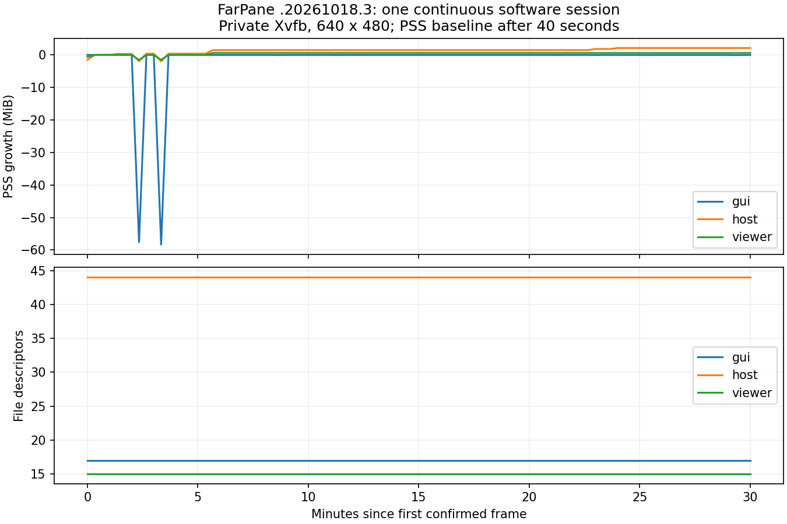

# FarPane Linux GPU 媒体重构（linux-host）：持续连接检查

2026-10-18。中文输入的应用特判方案按用户要求暂缓。本项是独立的 GUI 生命周期验收，复用冻结的 `.20261018.3` 候选 `farpane-native-dev-d393fd0cff634416807feae5`；不构建当前工作区、不带入 `0044` 实验、不安装或切换服务。

## 测试范围

原计划要求持续连接 30 分钟、20 轮重连及发布前 24 小时长稳。此前[二十轮重连](viewer-lifecycle.md)只证明反复建立/回收的局部结果，本项单独检查连续连接。测试使用真实包内 GUI、独立 Viewer 和 Host，完成密码认证、软件视频显示、主动断开及关闭 GUI；没有产品内部自动操作 hook。

私有 Xvfb 中，外部 XTest 点击首页、密码和断开按钮。长测的远端合成桌面每 20 秒显示一种从未在本轮用过的颜色：改变前先验证远端色块内部的取样区域没有该颜色，再要求 5 秒内实际显示超过 15,000 个匹配像素。区域限定在固定布局中 260×180 的色块内部，不计入工具栏、边缘或其他窗口像素。颜色间隔超过像素容差，防止旧帧误判为新画面。短测压缩间隔，同样覆盖全部 91 种颜色。计时从首次确认出图开始，最后一次更新发生在完整目标时长之后；不是从进程启动或认证开始计时。该观测时长包含测试轮询，不作为网络延迟指标。

每次更新采样 GUI/Viewer/Host 的 PID、起始标识、PSS/USS/RSS/SwapPss、FD、线程、子进程及软件帧映射，保存原始 smaps。核对窗口、Viewer 进程与已认证入站 ID 不变，不能由自动重连掩盖中断。结束后确认 Viewer 消失、Host 入站清空、首页无软件帧映射，关闭 GUI 后 Host 仍存活。

40 秒后记录 FD 是否稳定，以及 PSS、线程的范围和增长；不把三进程的软件样本套用 GPU 预算，不临时修改分配器或主动 trim。持续连接测试通过也不等于首页 60 MiB、全部内存预算、真实桌面、root 监管、GPU/fence、音频/文件并发或 24 小时验收通过。

## 隔离与复现

```sh
# 只确认测试入口，不能计为 30 分钟通过。
python3 -B Scripts/linux/test-native-sustained.py \
  Build/Linux/artifacts/farpane-native-dev-d393fd0cff634416807feae5 --seconds 60

python3 -B Scripts/linux/test-native-sustained.py \
  Build/Linux/artifacts/farpane-native-dev-d393fd0cff634416807feae5 --seconds 1800
```

入口先校验已有 bundle 的完整 manifest，再复制测试源码快照并记录 SHA-256。只给容器挂载该只读 artifact、所需测试/校验源码和本次输出目录，不挂载整个仓库、Build 缓存、用户配置或宿主桌面。复用固定 native builder 镜像，禁网、只读根目录、4 核/6 GiB，无 GPU/input/KVM，产品进程降为普通用户；HOME、XDG 配置、X11 与用户总线均为私有。容器内外分别有目标时长 +120/+150 秒上限，异常时仅清理本次随机命名容器。

只接受 60/1800 秒，不创建定时任务。测试入口的宿主误执行、继承显示环境、设备暴露、颜色碰撞及无关区域拒绝检查已通过四项单测。

## 当前结果

首轮短测 `run-reo4q8qf` 已认证，但最初颜色与暗色界面相近，被“颜色事先存在”检查拒绝；没有把它计为应用失败或连接通过。后续排除近灰色并验证所有 91 个挑战颜色的容差区间互不重叠。失败和后续结果分别保留在 `Build/Linux/native-sustained/`，以 `sustained-result.json` 及启动进程实际退出状态为准。

短测 `run-37070fk4` 已实际退出为 0：连续出图 60.131 秒，4 次颜色检查通过，同一 GUI/Host/Viewer，FD 固定为 17/44/15；40 秒至结束，三者 PSS 分别变化 0/+16/0 KiB。主动断开后 Viewer 回收、首页软件帧映射归零，关闭 GUI 后 Host 保留。`thirty_minute_gate=false`，不能用这一分钟关闭 30 分钟门槛。

首个长测 `run-ycewdmkc` 在第五次挑战的颜色预检查被拒绝，命令会话 `76834` 已退出 1，容器已结束。旧检查跨越整个远程视图，未限制到合成色块内部；四次成功样本不能证明整套挑战有效，不能把本次失败记为长稳通过。

随后把取样限定到色块内部，并让短测覆盖全部 91 种颜色。`run-edx2ya0g` 实际退出 0：60.112 秒、91 次新画面，FD 固定为 17/44/15，40 秒后 PSS 增量 GUI/Host/Viewer 为 0/+12/0 KiB，退出回收检查通过。该轮是完整调色板的夹具验证，仍不是 30 分钟结果；没有修改产品。

修正后长测 `run-fyslr5yc` 已完成：连续出图 **1,800.112 秒，91 次新颜色检查全部通过**。命令会话 `38625` 已退出 0，私有容器 `farpane-sustained-f5d89204775a` 已删除。原 GUI/Host/Viewer 的 PID 与起始标识全程相同；断开后 Viewer 消失、Host 入站清空、首页软件帧映射归零，关闭 GUI 后 Host 保留。没有自动重连掩盖中断。`progress.json` 保留末次运行中采样，最终状态以 `exit.json` 和 `sustained-result.json` 为准；不要再等待旧句柄或重复启动。

| 角色 | 40 秒预热后的最大 PSS 增量 | 最终 PSS | 最后约 5 分钟 PSS 增量 | FD 范围 |
| --- | ---: | ---: | ---: | ---: |
| GUI | 0 KiB | 157,520 KiB | 0 KiB | 17–17 |
| Host | 2,180 KiB（约 2.13 MiB） | 109,760 KiB | 0 KiB | 44–44 |
| Viewer | 616 KiB（约 0.60 MiB） | 16,857 KiB | 0 KiB | 15–15 |

三进程 SwapPss 全为零。相同预热后区间的平均 CPU 为单核约 1.003% / 2.149% / 0.299%；这是低频改变 640×480 软件画面的私有夹具，不能与实际 GPU 桌面或首页空闲目标比较。Host 在第 23–24 分钟有两次小幅 PSS 上升，原始曲线完整保留，最终约五分钟持平；一次有限时长结果不排除更长期增长。



测量环境补充：第 2–4 分钟另有同镜像的 [GUI 总线故障检查](desktop-bus-recovery.md#gui-自身总线中断的退出与恢复)并行。GUI PSS 曾从 157,532 KiB 暂时降到 97,821 KiB；smaps 对比确认 LLVM、Gallium、GTK、libadwaita 和字体的 Private_Clean 转为共享页分摊，主要映射的 Private_Dirty 保持不变。这两次下降不计为优化，也不宣称本轮是排除其他负载后的性能 A/B。归因数据在 `shared-page-dip.json`，完整 smaps 保留。

本项通过的是 **30 分钟隔离软件视频连续连接与退出回收检查**。24 小时、GPU/fence/真实桌面、首页 60 MiB、全部进程预算、物理音频/多功能并发及 Mac 中文输入仍未验收，完整 GUI 目标没有关闭。

短测原始记录见[本轮证据](../../Evidence/LinuxHost/2026-10-18-native-sustained/README.md)。已安装 `.1`、旧 `.3` artifact 与服务保持不变，中文输入缺陷继续保持打开。

## 结束后的资源分析

```sh
# 这里容器与宿主共享内核，实测 getconf CLK_TCK 为 100。
python3 -B Scripts/linux/analyze-native-sustained.py \
  Build/Linux/native-sustained/RUN --clock-ticks 100 --plot
```

分析器拒绝未终态/失败运行，核对 91 份样本、原二进制与冻结 manifest、精确测试源码哈希、进程起始标识、唯一颜色、时序、实际像素及完整回收。输出原始时间序列 CSV、PSS 增量/FD 图和 JSON；CPU 由同一进程 `/proc` tick 差和实际采样跨度计算，按单核百分比报告，三进程为依次采样。图像观察等待含测试轮询，不能称为端到端网络延迟。软件样本不计 root、合成器、GPU 或测试辅助进程，不能据此通过完整产品预算。

用已完成的 60 秒原始记录及其内存副本进行八项检查：正常短测仅按短测接受；缺少末样本、短测冒充 30 分钟、worker 身份变化、颜色重放、非数值时间、worker 未回收及 FD 增长却宣称稳定均被拒绝。原始文件和产品未修改。最后 5 分钟 PSS 变化会单独报告，不将 FD 稳定或一次有限时长结果宣称为排除长期泄漏。
