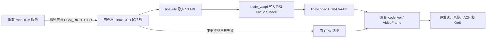

# Linux Host GPU 媒体路径重构方案

日期：2026-10-16，Asia/Shanghai。状态：最终讨论版；已按用户“新版优先”的要求修订，并经 Codex 与 Claude 确认。仅方案，未开始产品实现。

## 决策与证据

建议实施限定范围的 Linux Host 媒体路径重构原型，以显著降低持续连接时的 CPU。首版针对 hermes 当前环境，保留现有 CPU 路径作为回退。UI 框架、Linux Viewer、协议认证和 Mac 客户端不进入这次改造。

两轮实验的结果：

| 实验 | 实测 | 能证明什么 |
|---|---|---|
| RustDesk 1.5.0 复用输出缓冲区 | 总 CPU 相对下降 11.6%～15.3%；PSS 仅差约 4～5 MiB | 去掉一次整帧复制有效，但不满足明显降低 CPU/内存的目标 |
| 同参数 FFmpeg GPU/RAM 对照 | GPU CPU 3.52/3.86/3.94%，RAM 40.30/40.75/40.75%；中位下降 90.5% | 当前显示条件下，避免 CPU 整帧读回、转换和上传有很大潜力 |
| 当前原版 RustDesk 短基线 | 五进程 CPU 33.43% / 34.38%；drm-recv 18.53% / 18.76% | FFmpeg GPU 全媒体路径约 3.9%，低于现有单独采集线程 |

所有 CPU 均以一个逻辑核为 100%。FFmpeg 对照不是 RustDesk 的精确复刻，90.5% 不能外推为完整客户端降幅。GPU/RAM 编码均约 29.86 FPS；独立 90 帧码流解码成功。924 条 Viewer 记录均处于 streaming，同一连接代际，无新增解码错误、重置或包间断。

FFmpeg 进程 PSS 为 46.8 / 93.4 MiB，但不完整计入 GPU surface，不能据此宣称整机内存减半。常驻 UI/CM 的内存另行评估，活动连接可能依赖 CM，不预先承诺节省 170 MiB。

详细证据：[输出缓冲区实验](/Users/xiaobei/Documents/xiaobei/farpane/Evidence/LinuxHost/2026-10-15-output-buffer/README.md)、[GPU 直通实验](/Users/xiaobei/Documents/xiaobei/farpane/Evidence/LinuxHost/2026-10-16-ffmpeg-gpu/README.md)。

## 仓库、交付与开发位置

用户已确认同一个 FarPane 仓库、分平台构建。Linux 新实现、版本锁定、RustDesk/hwcodec 补丁和打包配置归入独立 `Linux/` 目录，构建入口归入 `Scripts/linux/`；现有 Mac 目录保持不动。上游源码和编译产物放在忽略的构建目录，Git 保存我们自己的源文件、补丁和可复现的依赖清单，不能把实验 checkout 当作唯一源码。

FFmpeg 必需库随软件交付，优先静态链接进 Linux 核心库；若实际构建必须使用动态库，则放在应用私有目录并固定加载路径，不使用主机安装的 `ffmpeg` 命令或任意系统 `libav*`。GPU 驱动/VA-API 后端仍来自系统，需声明最低环境并进行能力探测。打包验收必须包含未安装系统 FFmpeg 的干净环境及加载库检查。

用户指定在独立分支开发：本机与 hermes 已从 `32b06d2d4e7e0962ddb7152b7891d600703c9f81` 创建 `codex/linux-host-gpu-media`。Linux 实现由 hermes 的 Codex 承担；当前工作区为 `/home/xiaobei/Documents/xiaobei/farpane`。不得切回 main 编辑、合并、提交、推送或发布，除非用户后续明确要求对应动作。保持现有运行服务和配置不变。

## 首版支持边界

实施补充（2026-10-16 UTC）：首次用户实连查明，hermes 实际 scanout 是隐式 AMD 分块布局；
原实验 KMS state 的 `modifier=0` 未证明 modifier 有效。为使本机 GPU 管线实际工作，
现保留同设备/格式/显示门槛，增加由 VAAPI 驱动推断的 INVALID modifier 导入，
不将未知布局强制改为线性。详细证据、截图冷路径和验证见
[隐式布局修正](../Linux/docs/implicit-layout.md)。下面“仅 linear”是原计划边界，已由此补充修正。

目标为 Linux x86_64、hermes 的 AMD Radeon 780M/Mesa、Wayland 单显示器、SDR、无旋转、H.264、XR24/AR24 且 **linear modifier=0**。实际首帧描述符、设备匹配、导入、转换和编码探测全部通过后才允许选择 GPU 后端。

当前 hermes 为 amdgpu Virtual-1；物理输出、tiled/DCC、其他格式、HDR、旋转、多屏组合、其他 GPU/驱动、非 H.264 协商均保持旧路径。显示模式或设备改变后重新判断资格。首版不尝试自动修复不支持的 modifier，也不强制客户端改变协商的编码器。

保留上一轮输出缓冲区补丁，用于 CPU 回退路径。GPU 功能默认关闭，作为独立 Linux feature 与运行开关启用，避免跨平台影响。

## 技术路线

**新 Linux 构建以 FFmpeg 9.0.2 为目标。** 官方下载页目前列出它为最新稳定版（2026-09-18 发布），8.1 维护分支当前为 8.1.3。版本在实施开始时再次核验，随后固定源码版本、校验值、配置和构建工具链，不跟随 master 浮动。参见 [FFmpeg 官方发布信息](https://ffmpeg.org/download.html)。

原先沿用 7.1.1 仅是减少实验变量的保守做法，不是技术要求。既然独立维护 Linux 媒体模块，不再把旧版本和 `disable-avfilter` 当成设计约束。9.0.2 若出现已复现的 API/驱动/回归阻塞，且解决代价明显超出本项目，才把 8.1.3 作为需说明原因的兼容备选；不静默回到 7.1.1，不把任何分支称为未经官方承诺的 LTS。

采用窄 C/Rust 适配模块，默认复用官方精简滤镜路径：`buffer → hwmap → scale_vaapi(format=nv12) → buffersink → h264_vaapi`。输入是现有 DRM 服务提供的硬件帧，产品不需要 kmsgrab/avdevice；CPU 读回、CPU 像素转换和再上传不进入正常视频热路径。编码器使用滤镜输出兼容的 `AVHWFramesContext`，通过引用计数管理寿命，并显式限制在途帧和池增长。

只启用所需滤镜及现有功能必需的编解码组件，不开启全量滤镜、额外网络/采集设备。不把 FFmpeg CLI 子进程作为产品依赖，不先引入新的常驻媒体进程。官方滤镜比手工维护 VPP 更接近实测链路，颜色、设备与重配处理优先复用上游实现。

**依赖事实已经核对：**实验使用系统 FFmpeg 8.0.1；旧 RustDesk 1.5.0 vcpkg overlay 为 7.1.1，实际 libavutil 为 59.39，`avfilter`、`avdevice`、`swscale` 被禁用，已有 `CONFIG_LIBDRM=1`、`CONFIG_VAAPI=1`、`CONFIG_H264_VAAPI_ENCODER=1`。这些是旧基线事实，不是新构建限制。9.0.2 的 API、构建及 GPU 性能仍须 P0 重新验证，不能用 8.0.1 的结果直接背书。

**同一个 Linux 进程只能使用一致的一套 FFmpeg 头文件、ABI 和库。** RustDesk、hwcodec 及新模块全部针对新版本重新编译，适配实际遇到的已移除 API；不混用 7.x/9.x 对象或符号。Linux 单独固定依赖和产物，Mac/Windows 不顺带升级。因同一 Linux 二进制还含 Viewer，已有 FFmpeg 解码器和 CPU 回退也必须回归，不能只测新 Host 编码。升级旧绑定所需的最小兼容改动属于本次明确范围，和 GPU 改造分开验证。

备选为 `av_hwframe_map + 窄 libva VPP + libavcodec`：只有精简滤镜路径实测带来不可接受的 CPU/延迟、无法满足生命周期/credit、或构建阻塞时才切换。不能因为旧 portfile 关闭了 avfilter，就优先自写颜色转换与 VPP。

## 代码接入与行为保持

复用原 `video_service` 主循环、`EncoderApi`、`handle_one_frame`、录像、`VideoFrameController`、QoS、编码协商和新订阅者切换，不复制一套独立发送主循环。

现有 `Frame::Texture`/`EncodeInput::Texture` 是裸指针加旋转信息，不能表达 DMA-BUF 的所有权和 credit。新增 Linux feature 限定的有类型帧、编码输入和配置分支，例如 `LinuxGpu`，由新 `LinuxGpuEncoder` 实现原 `EncoderApi`。GPU 帧携带 owned lease/Arc，不把只借用 capturer 的引用交给异步硬件。保持 `TraitCapturer`、`TraitPixelBuffer`、`EncoderApi` 的方法签名和旧 Texture/HwRamEncoder 的行为；FFmpeg 升级所必需的绑定适配另列。内部 enum 的新增 variant 使用 Linux + feature 双重门控，逐项审查穷尽 match，验证 Linux feature-off、Windows、macOS 构建。

Capturer 和 encoder 成对选择、成对重建。协商变为非 H.264、GPU 失效或编码器切换时，capturer 必须同时回到 CPU 输出，不能把 GPU 帧递给 CPU encoder 再临时转换。码率/帧率不能在线更新时，沿用 SWITCH 重建 graph 与 encoder，之后先发参数集和 IDR。

预期改动范围：

| 位置 | 必要变化 |
|---|---|
| 新 Linux GPU 模块及窄 C FFI | 精简滤镜 graph、编码、硬件帧引用、错误分类 |
| `drm_capturer.rs` 或其专用相邻模块 | 接收并管理有所有权的 DMA-BUF 帧，保留 cursor 元数据处理 |
| scrap `common/mod.rs`、`codec.rs` | Linux 限定的帧/编码器分支及工厂接入 |
| `video_service.rs` | 后端选择和 GPU 截图等必要接点；复用控制与发送 |
| Linux 构建配置与 hwcodec 兼容层 | pin 新 FFmpeg，最小组件构建；同进程统一链接；必要旧 API 适配与原功能回归 |

Root 服务继续只导出描述符/FD，不向 root 加载 GPU 编码栈，不给整个用户态 RustDesk 增加特权。正常情况下不改 DRM IPC schema、网络消息或认证配置。新代码明确校验尺寸、plane 数量、offset/pitch、整数溢出、格式、modifier 和设备身份。

Mac 端只借鉴“原始帧保留在平台媒体链路，编码后的 access unit 进入 RustDesk”这一边界。其 1.4.9 基线、Swift、ScreenCaptureKit 和 ABI 不直接移植到 Linux 1.5.0。

## 所有权、同步与回退

1. 每帧 FD 使用 `OwnedFd`/有类型租约管理；FD 保持对象存活，不等于冻结 compositor 的写入。沿用当前 KMS 捕获的隐式同步前提，P0 核对实际导入/提交时的 fence 契约，并进行动态撕裂/混帧验证。已有 CPU/EGL 路径也存在这一共享前提，不能因此忽略验证或宣称 GPU 已获得不可变快照。
2. VPP 写入自有 NV12 帧。graph 提交成功、返回输出 AVFrame 或编码器接受帧，都不能直接当作 GPU 读取已完成。独立保留源 owned lease，取得输出 VAAPI surface 后，对该目标 surface 做有界完成确认，成功后才归还源 credit；编码器仍引用 NV12 时不得重用它。未提交的被替换帧可以立即释放并还 credit。超时不是完成，不能让 Drop 无条件关闭仍被使用的 FD 或归还 credit；owner 保留资源到安全完成/合法上下文清理，恰好释放一次。IPC 已关闭时不继续写 ACK。若所选版本无法提供可验证的完成点，P0 不通过，不能悄悄改成“提交即 ACK”。
3. 保持现有 `credit=2` 和有界最新帧语义，限制待处理 FD、NV12 surface 和压缩包队列；池不能靠持续分配掩盖背压。旧 generation 的帧和编码结果不得进入新显示/编码配置。限制值由 P0 按编码器真实最小需求确认，不臆定“两个 surface 足够”。
4. VADisplay、graph、VAContext、AVCodecContext 由同一专用媒体线程管理，不在全局锁或 Tokio 线程内等待。完成等待优先 `vaSyncSurface2`，兼容方式为状态查询和期限；EAGAIN、poll、flush/排空循环都设截止时间。驱动提交调用本身未必可强制中断，不能跨线程销毁正在使用的上下文来伪造超时保障。GPU/内核整体挂死不承诺无感恢复。
5. 同一显示/连接代际只有一个生产后端。常规导入、格式、VPP、编码失败或超时，停止新 GPU 提交，安全清理旧代际，再切回原 CPU 编码；先发送有效参数集与 IDR，不混合旧参考链。失败禁用标记不能因 `SWITCH` 自动重建而丢失，避免反复尝试。仅新连接、显示/设备变化或明确重试重新探测。
6. 截图是冷路径：保留显式请求时的一次受控读回，不能静默丢失功能，也不能将每帧读回伪装成 GPU 通路。录像继续复用编码后消息。光标位置/标定元数据沿用现有流程；当前 `on_cursor_plane` 不读取帧像素。

滤镜输出的 VAAPI AVFrame 提供目标 VASurfaceID 和对应 device context。完成等待放在 `avcodec_send_frame` **之前**，成功后还源 credit，再提交 NV12 帧编码，避免把 credit 无意延迟到编码结束。P0 实测这次同步等待的成本以及驱动是否遵守超时；超时测试须确认存在未完成工作，不能把“1ns 调用已经完成的 surface 返回成功”误判为驱动不遵守期限。具体结构访问与 API 以所 pin 的新版头文件为准。

P1 前列出所有 CPU 像素消费者，包括截图、首帧/变化判断、隐私/黑屏逻辑和显示检测，逐项选择保持原逻辑、使用元数据或显式冷路径读回，不能因新 enum 分支而静默失效。销毁顺序遵循实际引用所有权：停止提交，安全排空/隔离在途工作，释放应用及 graph/encoder 持有的帧，最后释放帧池和 device 引用。由 `AVHWDeviceContext` 拥有的 VADisplay 不再手工 `vaTerminate`，避免双重销毁。

刷新、QoS 码率/帧率、编码器切换和新订阅者继续遵循原控制流程；需要重建编码器时使用原 `SWITCH` 机制。H.264 封装、参数集、关键帧和 PTS 遵循现有 Linux 发送与客户端解码契约，不直接照搬 Mac 的 AVCC 细节。

## 分阶段实施与退出条件

| 阶段 | 工作与产物 | 通过条件 |
|---|---|---|
| P0 新依赖与正确性验证 | 9.0.2 全 Linux 构建及原路径回归；独立 harness 跑官方 GPU graph；色卡、帧租约、surface/FD 上限、同步和失败释放；确定延迟测法 | 用产品实际库和用户态权限跑通；颜色/生命周期可解释，无静默 CPU 退化；不接管当前连接 |
| P1 受开关控制的集成 | 新 GPU 帧/编码器接原主循环；截图/光标/录像、QoS/Refresh、降级与代际隔离 | 开关关闭行为保持；支持条件下真实端到端显示，不支持和注入失败走旧路径 |
| P2 性能与质量 A/B | 按下方四层基线区分升级和 GPU 改造；静态/滚动文字/视频，各三轮≥120秒，预热并交错顺序 | C 对原版总 CPU 至少下降 50%，并有独立 GPU 增量价值，质量/帧率/延迟全部通过 |
| P3 生命周期与长稳 | 30～60分钟混合负载，重连、锁屏恢复、分辨率/显示变化、降级测试，再24小时连接观察 | 无新解码错误、挂死、黑屏和资源累积；确认一键回退后再讨论默认启用 |

P0 必须显式对齐原 CPU 转换的矩阵、range、色度采样与 SPS VUI，以及 Mac/原版 Viewer 的解释。使用固定色块比较编码前 Y/UV 数值并检查解码后的色彩、灰阶和细文字；允许合理舍入差异，阈值在测试前固定，不能看完结果后放宽。

归因基线必须分开保存：A0＝旧依赖原版；A1＝旧依赖＋已测输出缓冲区补丁；B0＝新 FFmpeg＋同一小补丁、仍走 CPU 路径；C＝B0＋GPU 路径。A1→B0 衡量依赖升级，B0→C 衡量 GPU 改造，A0→C 衡量用户最终收益。先完成 B0 回归和短 A/B，不能把升级带来的变化归功于 GPU。若仅升级已经满足目标，允许停止进一步 GPU 改造。若 B0 出现回归，先修复或说明版本备选理由，不继续叠加新路径掩盖问题。

端到端延迟测法在 P0 冻结并先测原版基线：使用带序号/时间码的可控画面，匹配源呈现与诊断 Viewer 的呈现事件，通过同钟或误差可量化的校准比较。测试诊断工具不替换当前 Mac App。若现有工具只能测处理段，明确保留端到端门槛未关闭；不能以 `videoReceiveAgeMS` 或 `presentationAgeMS` 代替。

## 验收口径与止损

- **CPU：**以五个 RustDesk 进程的总量为主，单列 server/drm-recv、root service、GNOME、GPU 引擎和采样离散度。目标相对原版下降≥50%，当前约34%单核仅作量级参考；执行时重新测基线。30%～50% 进入投入价值复评，不能按“大幅达标”默认启用；<30% 或出现质量/可靠性回归则停止扩大改造。
- **帧率与质量：**同分辨率、编码器、目标 FPS、相近实际码率和可比较画质，收到/呈现 FPS 下降不超过3%；不得通过降帧、降分辨率或显著降低质量达标。文字、色彩、光标和画面完整性都需真实查看。
- **延迟：**P95 端到端延迟不得超出预先确定的测量误差/容差；单列处理段与端到端结果。容差由 P0 仪器精度冻结，未定义/未测不能宣布通过。
- **内存与 FD：**记录 PSS、USS、GPU surface/显存或共享内存和 FD 趋势；每轮重连和分辨率切换后应回到稳定平台，24小时无持续累积。CPU 优化不宣称 UI/系统内存减半。
- **兼容：**FarPane Mac Viewer 与原版 RustDesk Viewer；H.264 协商、刷新、码率/FPS变化、新订阅者、截图/录像；不支持的编码、格式或显示配置必须可靠回退。其他 GPU 不作为首版已支持发布。

正式替换 hermes 服务做真实 A/B 会需要短暂重连。当前“不要影响现有连接”的约束继续有效：先完成离线/旁路开发；到切换或可能影响桌面的测试时，再安排用户同意的窗口。不得为了验收自行重启现有会话。

## 依据与保留的不确定性

原基线 RustDesk 1.5.0 pin：`fada664df7a294d1d1a9ca3e7cd3637069122f17`；libdrmtap 0.5.8 pin：`95d4d74549631aa5c39461300acfd2e106583cc9`；旧产品 FFmpeg 7.1.1；实验系统 8.0.1；新方案目标 9.0.2。已查阅 `drm_capturer.rs`、`ipc/drm.rs`、`video_service.rs`、scrap `common/mod.rs`/`codec.rs`/`vram.rs` 和 vcpkg overlay。

DMA-BUF 同步不是单纯的 FD 生命周期问题，CPU cache sync 也不提供互斥；见 [Linux dma-buf 文档](https://docs.kernel.org/driver-api/dma-buf.html)。官方滤镜用法参照 [FFmpeg hwmap](https://ffmpeg.org/ffmpeg-filters.html#hwmap)；实际 API/结构和生命周期必须再对照所 pin 的新版源码，不用旧版头文件推断兼容性。

尚未证明：9.0.2 全 Linux 构建的兼容性及集成性能、完整 RustDesk 最终降幅、原 server 剩余 CPU 的细分归因、色彩/端到端延迟、长期稳定性及非 linear 环境。因此这是可执行的分阶段方案，不是已完成重构或性能承诺。

讨论确认记录：OCS `lan-47e1f9fa6b514dae32da7a4f5ea91159`，Claude `claude-b74904e7@hermes` 在 seq 18（2026-10-16 09:20:31，Asia/Shanghai）确认“9.0.2 优先、8.1.3 具体阻塞时备选、官方精简 graph、外部源 lease 保留到输出 surface 完成才 ACK”，并认可四级基线与仅升级达标即可停止。该记录表示方案共识，不表示实现或运行验证已完成。
